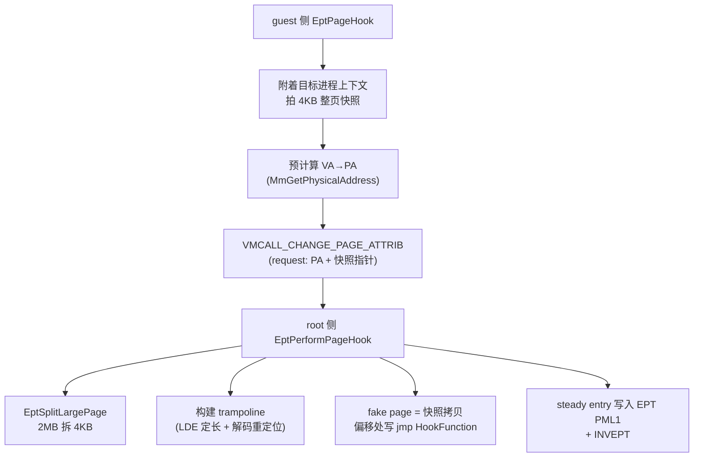

## 前言

写了这么多文章，说到底还是为了两个东西一个是 EPT Hook 另一个就是 EPT Shadow。

这篇文章先记录一下 EPT Hook 吧。

EPT 的每一页有独立的 R/W/X 权限位，这样我们就可以像 Page Hook 那样通过页面异常导致的 vmexit 来实现 Hook。

后面也会记录中间踩过的一些坑。

## EPT Hook

### 双视图

EPT Hook 的核心思想就是**对同一个 GPA，让"读"和"执行"看到两份不同的内存**。

- **执行视图**指向一张被改动的原页的拷贝，在目标函数的偏移处写了一条 `jmp HookFunction`。guest 一旦执行到这个页，就被重定向进我们的回调。
- **读写视图**指向原始页，原函数的字节一个都没动。所以任何做完整性校验的代码（比如反作弊扫自己的 `.text`）读到的都是干净的字节。这是纯软件 inline hook 天然做不到的事，因为软件 hook 必然改动实际指令字节。

这也是为什么 Hypervisor 的对抗怎么激烈，比如 AXE 或者是 EXC 检测到有 Hypervisor 提前加载就会主动调 `KeBugCheckEx`，也就是直接崩溃。

EXC 似乎还会使用某些神秘的做法直接让 CPU 挂起，对抗这些是真的头疼。

在 Sparkle 里，装配一条 exec hook 的完整链路是：



### violation/MTF 状态机

steady state（稳态）下 EPT 表项怎么设，决定了 hook 的语义。

全局 exec hook 的稳态 = fake page + 去 R/W 位，于是这个物理页上的**任何数据访问**都会触发 EPT violation，处理器介入，把原始页换回来让访问完成，再靠 **Monitor Trap Flag（MTF）** 在执行完毕后把 fake 页换回去。


也就是说，一次普通的数据读取要走**2 个 VM-exit**，这样的时钟开销就是检测 Hypervisor 一个比较常见的做法。

Sparkle 中的核心状态机代码长这样（节选自 `EptHandlePageHookExit`）：

```c
// Determine whether the faulting context belongs to the process this hook is scoped to
__vmx_vmread(GUEST_CR3, &GuestCr3);
GuestCr3 &= ~0xFFFULL; // strip PCID bits

IsTargetProcess = (HookedPage->TargetCr3 == 0) || (HookedPage->TargetCr3 == GuestCr3);

if (!ViolationQualification.EptExecutable && ViolationQualification.ExecuteAccess)
{
    if (HookedPage->IsExecutionHook && IsTargetProcess)
    {
        // 目标进程执行 → 换入 fake page（exec-only），指令在 fake 页上重执行
        EPT_PML1_ENTRY FakeEntry = HookedPage->SteadyEntry;
        FakeEntry.PageFrameNumber = HookedPage->PhysicalBaseAddressOfFakePageContents;
        FakeEntry.ReadAccess = 0;
        FakeEntry.WriteAccess = 0;
        FakeEntry.ExecuteAccess = 1;

        EptSetPML1AndInvalidateTLB(HookedPage->EntryAddress, FakeEntry, INVEPT_SINGLE_CONTEXT);
        GuestState[KeGetCurrentProcessorNumber()].IncrementRip = FALSE; // 重执行
        return TRUE;
    }
    else
    {
        // 非目标进程 → 放行一次 + MTF 恢复稳态
        EptArmMonitorTrapFlag(HookedPage, HookedPage->OriginalEntry, HookedPage->SteadyEntry);
        ...
    }
}
```

每个被 hook 的物理页有一条 `EPT_HOOKED_PAGE_DETAIL` 记录，挂着三个 EPT 表项快照：

| 字段 | 语义 |
|---|---|
| `OriginalEntry` | 原始 entry，R/W violation 时换入让数据访问完成 |
| `SteadyEntry` | 稳态 entry（fake 页或原始页去 X） |
| `ResumeEntry` | MTF exit 时要恢复的 entry，由 arm 时指定 |
| `TargetCr3` | hook 作用域|


## 实战的一些坑

### EPT 页面属性

这次测试的时候发现 Hook 安装成功了但是无效。

破往前翻 git，发现某个旧版本上同样的代码是工作的，diff 之后发现后面重构 vmcall handler 的时候改错了，后面并存着两套页属性常量：

```c
// ept.h —— guest 侧编 AttribMask 用这套
#define PAGE_ATTRIB_READ    0x2
#define PAGE_ATTRIB_WRITE   0x4
#define PAGE_ATTRIB_EXEC    0x8

// vmcall.h —— root 侧 handler 判位用这套
#define EPT_PAGE_ATTRIB_READ   0x1
#define EPT_PAGE_ATTRIB_WRITE  0x2
#define EPT_PAGE_ATTRIB_EXEC   0x4
```

guest 用 `PAGE_ATTRIB_EXEC = 0x8` 编请求，root 侧 handler 拿 `EPT_PAGE_ATTRIB_EXEC = 0x4` 去判位：

```
0x8 & 0x4 = 0
```

于是 `UnsetExecute` 恒为 FALSE，exec hook 分支整个被跳过。

所以驱动通信的协议也是比较麻烦的事，因为协议的事重构过很多次。

修复是显式的契约转换：

```c
ULONG requestedMask = 0;
if (attribMask & PAGE_ATTRIB_READ)  requestedMask |= EPT_PAGE_ATTRIB_READ;
if (attribMask & PAGE_ATTRIB_WRITE) requestedMask |= EPT_PAGE_ATTRIB_WRITE;
if (attribMask & PAGE_ATTRIB_EXEC)  requestedMask |= EPT_PAGE_ATTRIB_EXEC;
```

### trampoline 里的 RIP 相对指令

mask 修好之后exec hook 真正开始工作了。然后当场 BSOD `0x50`（PAGE_FAULT_IN_NONPAGED_AREA）。

WinDbg 检查 dump：

- **出错指令地址** = `0xFFFFD30CCE103776`，而 trampoline 分配在 `0xFFFFD30CCE103770+6`，正好是第三条指令；
- **trampoline 的前几条指令** = `40 53 | 48 83 EC 50 | 48 8B 05 disp32`，即 `push rbx; sub rsp,50h; mov rax,[rip+disp32]`——第三条就是 RIP 相对寻址；
- **解出的地址** = trampoline RIP + `0x6114F` = 池内存里的一段垃圾；而原指令在 win32k 原址上解出的是 `win32k+0x65C78` 的一个全局量（CFG 指针）。

后来发现，RIP 相对指令的有效地址按当前 RIP 计算，把这条指令原样拷到几百 GB 外的 trampoline 里，它读的就是另一个世界的内存。

不过后来也重构了从 win32k.sys 迁移到了 win32kfull.sys。

trampoline 构建的老代码用 LDE 量出前 N 字节定长截断，然后 `RtlCopyMemory` 原样搬运。

对 `push rbx`、`sub rsp,50h` 这种位置无关指令没问题，但 win32k 的 CFG 桩 prologue 全都带着 `mov rax,[rip+disp]`（读 CFG 检查函数指针），四个挂点全军覆没。

更早的 `NtCreateFile` 实测通过纯属运气好，它的 prologue 没有 RIP 相对指令。

修复方案是自研一个**最小 prologue 解码器**，只判断这条指令是不是 `mod=00 / rm=101` 的 RIP 相对寻址、disp32 在哪。

是就重写为绝对寻址：

```
mov r64, [rip+d]  →  movabs r64, EA ; mov r64, [r64]
lea r64, [rip+d]  →  movabs r64, EA
```

```c
if (decoded.IsRipRelative)
{
    INT32 disp;
    UINT64 effectiveAddress;
    ULONG dest = (((decoded.Rex >> 2) & 1) << 3) | ((decoded.ModrmByte >> 3) & 7);

    RtlCopyMemory(&disp, insn + decoded.DispOffset, sizeof(disp));
    effectiveAddress = (UINT64)TargetFunction + Consumed + ldeLen + (INT64)disp;

    /* movabs dest, EA */
    Point->Trampoline[Emitted++] = (CHAR)(0x48 | ((dest >> 3) & 1));
    Point->Trampoline[Emitted++] = (CHAR)(0xB8 | (dest & 7));
    *((PSIZE_T)&Point->Trampoline[Emitted]) = (SIZE_T)effectiveAddress;
    Emitted += 8;

    if (decoded.Opcode != 0x8D)   /* lea 只取地址，无需第二次访存 */
    {
        /* mov dest,[dest]，W 位继承原指令；mod=00 间接寻址三个特例：
           rm=4 需 SIB 0x24、rm=5 用 mod=01+disp8=0 表达 [rbp]、其余直取 */
        ...
    }
}
```

解码器收得很窄操作码不在支持集就直接拒绝挂 hook，于是就有了后面引入 Zydis 的改动。

### root 访问 PAI

重定位修好，这次撑得久了一点，然后 BSOD `d1`（KERNEL_MODE_EXCEPTION_NOT_HANDLED，写非驻留页）。

后面发现 root 里还剩两类对 win32k 会话 VA 的直接读取：fake page 的整页拷贝，和 LDE 解码时读指令字节。

而 win32k 是**可分页的会话驱动**，冷枚举函数的代码页会被会话工作集裁掉。被裁掉之后：

- PTE 变 non-present，但 PFN 位还在（transition/standby）
- `MmGetPhysicalAddress` **不校验 valid 位，照样返回非零**
- root 读这个非驻留页时**不能缺页**（root 没有缺页处理，也不会有）→ d1。

所以这个 bug 也很难发现，基本触发随缘。

修复是快照化：guest 在附着目标进程的状态下（PASSIVE_LEVEL，读操作顺手触发软缺页把冷页拉回驻留）先拍 4KB 整页快照，再预计算 PA ，快照指针随 VMCALL 请求带给 root：

```c
pageSnapshot = ExAllocatePool2(POOL_FLAG_NON_PAGED, PAGE_SIZE, EPT_POOL_TAG);
__try {
    RtlCopyMemory(pageSnapshot, PAGE_ALIGN(TargetAddress), PAGE_SIZE);
} __except (EXCEPTION_EXECUTE_HANDLER) { ... }

precomputedPhysical = MmVirtualAddressToPhysicalAddress(PAGE_ALIGN(TargetAddress));
```

root 侧从此对快照指针做拷贝和解码，目标 VA 只参与地址数学，不出现在任何解引用的位置。

### rel32

在给另一条挂点路径排 fast-fail 时发现 prologue 里的 `jcc rel32`（`0F 8x`）如果原样拷进 trampoline，位移量会按 trampoline 的地址解释。

一条本来往前跳 0x14E520 字节的 `je`，从池区出发就跳进了完全无关的内存。

`call rel32`、`jmp rel8` 同理。

之前没有问题是因为 win32k 的四个 CFG 桩 prologue 恰好没有分支，而这条新路径的 prologue 有。

修法和 RIP 相对一脉相承：**分支语义 = 目标地址 = 原地址 + 指令尾 + disp，这个目标在搬运前后不能变，要变的是 disp 本身**：

```c
UINT64 branchEnd = (UINT64)TargetFunction + Consumed + ldeLen;
UINT64 target = branchEnd + disp;              /* 原目标，不变 */
UINT64 newEnd = (UINT64)Point->Trampoline + Emitted + ldeLen;
INT64 newDisp = (INT64)(target - newEnd);      /* 新位移，重算 */

if (decoded.BranchDispSize == 4 &&
    (newDisp > 0x7FFFFFFF || newDisp < -0x80000000LL))
{
    /* rel32 跨出 ±2GB → 拒绝挂 hook */
    return FALSE;
}
```

## 结语

希望这里踩过的坑可以帮到下一个研究这个的人吧。

感谢观看。
